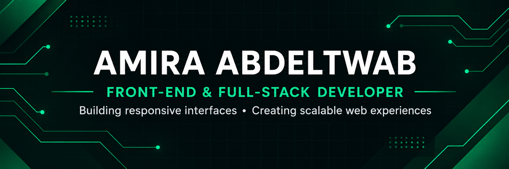

<!-- ================================================== -->
<!--                    HEADER                          -->
<!-- ================================================== -->

 

  

 

---

<!-- ================================================== -->
<!--                    ABOUT ME                        -->
<!-- ================================================== -->

## 👩‍💻 About Me

Hi! I'm **Amira Abdeltwab Saber**, a Junior Front-End Developer from Minia, Egypt 🇪🇬, passionate about building responsive, scalable, and user-friendly web applications.

I have a strong foundation in JavaScript, HTML5, CSS3, and React.js, with hands-on experience in developing real-world web interfaces, integrating RESTful APIs, and collaborating on Full-Stack projects.

My background in Educational Technology and E-Learning Development also helps me combine technical skills with user-centered thinking.

- 💻 Focused on Front-End Development and React.js.
- ⚛️ Interested in component-based architecture and state management.
- 🔧 Exploring Full-Stack Development using Node.js, Express.js, and MongoDB.
- 🚀 Team Lead & Full-Stack Developer of EcoLink graduation project.
- 🌱 Continuously improving my problem-solving and development skills.
- 🤝 Open to collaboration, learning opportunities, and development projects.

---

<!-- ================================================== -->
<!--                    TECH STACK                      -->
<!-- ================================================== -->

## 🛠️ Technical Skills

### Front-End Development

### Back-End Development & Databases

### Tools & Development Environment

### Additional Skills

- Component-Based Architecture
- RESTful API Integration
- State Management with Redux
- Performance Optimization
- Debugging & Problem Solving
- Agile / Scrum
- Team Leadership & Collaboration

---

<!-- ================================================== -->
<!--                    EXPERIENCE                      -->
<!-- ================================================== -->

## 💼 Professional Experience

### Front-End Developer | Minya University

**November 2024 – Present**

- Led the front-end design and development of the new Minya University Official Website.
- Built scalable and user-friendly web interfaces serving thousands of daily users.
- Developed component-based architecture and optimized website performance.
- Improved page load time by 30%.
- Integrated RESTful APIs for dynamic data fetching and management.
- Collaborated with back-end developers on Full-Stack development tasks.

### E-Learning Developer | Minya University

**June 2020 – June 2024**

- Designed and implemented structured e-learning courses using Articulate Storyline.
- Created interactive course elements, activities, and assessments.
- Participated in brainstorming, template creation, and quality assurance.
- Improved content quality and learner retention through interactive learning experiences.
- Combined instructional design with custom front-end coding.

---

<!-- ================================================== -->
<!--                    PROJECTS                        -->
<!-- ================================================== -->

## 🚀 Featured Projects

### 🌱 01. EcoLink – Centralized B2B Procurement Marketplace

**Turning Surplus into Sustainability**

A sustainable B2B marketplace connecting verified suppliers and buyers, facilitating material exchange and supporting circular economy practices.

**Role:** Team Lead & Full-Stack Developer

**Technologies:**
`React.js` `Redux` `Node.js` `Express.js` `MongoDB` `REST APIs`

**Key Contributions:**

- Led a development team throughout the project lifecycle under the Digital Egypt Pioneers Initiative (DEPI).
- Managed sprint planning, task delegation, and GitHub code reviews.
- Developed responsive React.js front-end components.
- Built Node.js and Express.js RESTful APIs integrated with MongoDB.
- Worked on authentication, global state management, and performance optimization.
- Designed a digital procurement experience connecting buyers and suppliers.

🔗 **[Live Demo](https://front-green-eta.vercel.app/)**

---

### 🎓 02. Minya University Official Website

A responsive university web portal developed to provide a modern and user-friendly experience for students, staff, and visitors.

**Technologies:**
`HTML5` `CSS3` `JavaScript` `Bootstrap` `REST APIs`

**Key Contributions:**

- Led the front-end design and development of the website.
- Built responsive layouts and reusable interface components.
- Improved page loading performance and cross-browser compatibility.
- Integrated RESTful APIs with back-end services.
- Focused on accessibility and user experience.

🔗 **[Visit Website](https://www.minia.edu.eg/Minia/)**

---

### 🎮 03. Educational Game

An interactive three-level educational game designed to create an engaging learning experience.

**Technologies:**
`HTML5` `CSS3` `JavaScript`

**Key Features:**

- Three progressive game levels.
- Progressive level unlocking.
- Detailed attempt tracking.
- Score summary and game logic algorithms.

🔗 **[Play the Game](https://amira-abd.github.io/Educational-game/)**

---

### 🚗 04. Uber – Ride-Hailing Front-End

A responsive ride-hailing interface featuring interactive booking and map-related functionality.

**Technologies:**
`React.js` `Redux` `REST APIs` `Google Maps API`

**Key Features:**

- Responsive ride-booking interface.
- Interactive ride-booking flow.
- Driver tracking and live location updates.
- Redux state management.
- API integration for route calculation and fare estimation.

🔗 **[Live Demo](https://amira-abd.github.io/Uber/)**

---

<!-- ================================================== -->
<!--                    EDUCATION                       -->
<!-- ================================================== -->

## 🎓 Education

### Special Diploma in Educational Technology
**Minya University | 2018 – 2020**

Specialization: Educational Design

Grade: Very Good

### Bachelor's Degree in Specific Education
**Minya University | 2017 – 2018**

Grade: Very Good

---

<!-- ================================================== -->
<!--                    CERTIFICATIONS                  -->
<!-- ================================================== -->

## 📜 Certifications & Professional Training

| Certification | Organization |
|---|---|
| Meta Front-End Developer Professional Certificate (9 Courses) | Coursera |
| Web Designer (120 Hours) | NTI |
| Articulate Storyline (7 Hours) | ITI MaharaTech |
| HTML & CSS (7 Hours) | ITI MaharaTech |
| Effective Presentations | HP LIFE |
| Careerflow LinkedIn Profile Completion | Coursera |
| AI Tools in Scientific Research & Idea Generation | Schobot |
| ICDL | EDRAAK / ITC, Minya University |
| Prompt Engineering | 1 Million Prompters Initiative |

---

<!-- ================================================== -->
<!--                    CURRENT FOCUS                   -->
<!-- ================================================== -->

## 🌱 Currently Focusing On

- ⚛️ Improving React.js development skills.
- 💡 Advanced JavaScript and TypeScript.
- 🔄 State management and reusable components.
- 🔌 RESTful API integration.
- 🖥️ Full-Stack application development.
- 🧩 Writing clean, maintainable, and reusable code.

---

<!-- ================================================== -->
<!--                    GITHUB ANALYTICS                -->
<!-- ================================================== -->

## 📊 GitHub Analytics

  

---

<!-- ================================================== -->
<!--                    CONNECT                         -->
<!-- ================================================== -->

## 🤝 Let's Connect

I'm always interested in connecting with developers, exchanging knowledge, and collaborating on innovative projects.

  

### 💚 Always Learning. Always Building. Always Growing.

